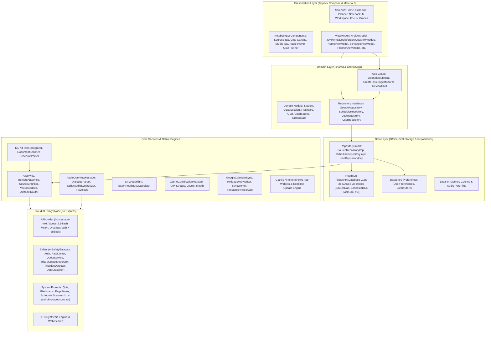
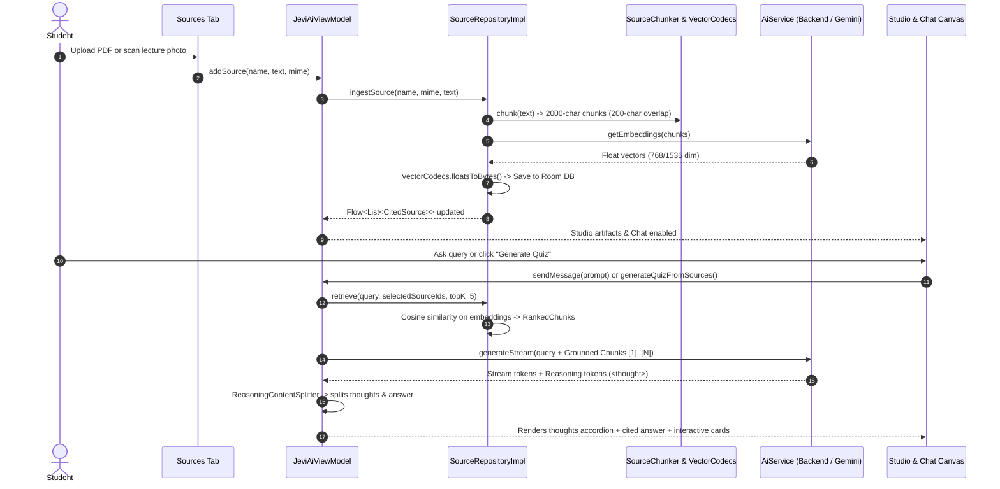
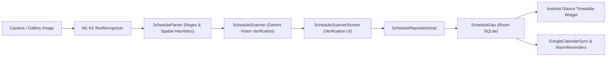
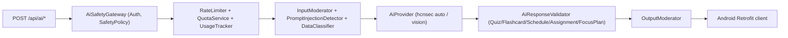

# Edukasyon (Student AI) — Comprehensive Architecture & Function Specification

> **Document Version:** 2.1.8  
> **Target Audience:** AI Agents, System Architects, Mobile Engineers  
> **Primary Package:** `com.edukasyon.studentai`  
> **Tech Stack:** Kotlin Multiplatform (KMP, Android-only shipping), Jetpack Compose, Material 3, Dagger Hilt, Room Database (v13, 28 entities / 25 DAOs), ML Kit, Firebase, Node.js AI Proxy (hcnsec `auto` / `agnes-2.5-flash`)

---

## 1. Executive Summary & Core Purpose

**Edukasyon (Student AI)** is an all-in-one academic intelligence operating system for students. It replaces the fragmented landscape of disconnected student apps (separate apps for timetables, assignment trackers, flashcards, Pomodoro timers, GPA calculators, and generic AI chatbots) by uniting them into a **single, cohesive, source-grounded ecosystem**.

### 1.1 The Core Problem It Solves
1. **Academic Fragmentation:** Students manage syllabi in PDFs, classes in calendar apps, homework in todo lists, and notes in separate notebooks. Context is lost across transitions.
2. **AI Hallucinations in Study:** Generic chatbots invent facts, historical dates, and formulas when asked about class lectures.
3. **Passive Studying vs. Active Recall:** Students read notes passively rather than testing themselves with spaced repetition, quizzes, or structured dialogue.

### 1.2 The Solution Architecture
Edukasyon solves this through four foundational pillars:
- **Jevi AI (NotebookLM-Style Studio Workspace):** An AI study partner grounded strictly in student-uploaded study materials (PDFs, lecture slides, scanned notebook photos, syllabus pages, and verified web research). It generates interactive quizzes, spaced-repetition flashcards, executive briefing reports, mind maps, slide decks, and multi-voice audio podcast overviews.
- **Academic Lifecycle OS:** Complete schedule management (with optical schedule scanning via Google ML Kit OCR), intelligent assignment decomposition, exam countdowns, and weighted GPA forecasting.
- **Cognitive Study Science:** Implementation of the **SuperMemo-2 (SM-2)** spaced repetition algorithm for flashcards, Pomodoro focus engines with ambient audio, and exam readiness indexing.
- **Adaptive Gamification & Emotional Companion (Gizmo):** A companion mascot reflecting the student's study habits, awarding XP, tracking streaks, and dynamically changing expressions based on daily academic activity.

---

## 2. High-Level Architectural Blueprint

Edukasyon adopts **Clean Architecture** combined with **Unidirectional Data Flow (MVI/MVVM)** and an **Offline-First Reactive Repository Pattern**.



---

## 3. Module & Directory Hierarchy

The project is structured as a Kotlin Multiplatform workspace:

```text
edukasyon/
├── shared/                              # Kotlin Multiplatform Shared Code
│   ├── src/commonMain/kotlin/com/edukasyon/studentai/
│   │   ├── ai/                          # Shared AI parsing (ReasoningContentSplitter)
│   │   ├── config/                      # Backend endpoints & configuration
│   │   ├── domain/model/                # Multiplatform domain entities & enums
│   │   ├── domain/repository/           # Common repository interface definitions
│   │   ├── network/                     # Ktor HTTP client & AI DTO definitions
│   │   └── util/                        # Multiplatform ID generators & helpers
│   ├── src/androidMain/                 # Android-specific KMP bindings
│   └── src/iosMain/                     # iOS-specific KMP bindings
│
├── androidApp/                          # Android Native Application
│   ├── src/main/kotlin/com/edukasyon/studentai/
│   │   ├── core/                        # Core algorithmic, native & AI service engines
│   │   │   ├── ai/                      # RAG Chunker, Vector Codecs, Actions, Quotas
│   │   │   ├── audio/                   # Podcast Audio Overview synthesis & players
│   │   │   ├── backup/                  # Local JSON / file data backup engines
│   │   │   ├── document/                # PDF, DOCX, TXT parsing & text extractors
│   │   │   ├── feedback/                # In-app bug & rating feedback handlers
│   │   │   ├── firebase/                # Firebase Auth & Firestore sync managers
│   │   │   ├── gamification/            # Gizmo mascot companion state machine
│   │   │   ├── mlkit/                   # ML Kit OCR for documents & timetables
│   │   │   ├── network/                 # Retrofit / OkHttp clients & connectivity
│   │   │   ├── notifications/           # WorkManager reminders & notification channels
│   │   │   ├── share/                   # QR code export/import for decks & schedules
│   │   │   ├── study/                   # SM-2 algorithm & exam readiness math
│   │   │   ├── sync/                    # Google Calendar & Holiday sync workers
│   │   │   ├── update/                  # In-app OTA update checkers & changelog
│   │   │   └── util/                    # Validation, formatting, and date helpers
│   │   ├── data/                        # Local persistence & repository implementations
│   │   │   ├── local/dao/               # 19 Room Data Access Objects
│   │   │   ├── local/entity/            # SQLite Room tables & relations
│   │   │   ├── mapper/                  # Entity <-> Domain Model mappers
│   │   │   ├── preferences/             # DataStore UserPreferences
│   │   │   └── repository/              # Repository implementations
│   │   ├── di/                          # Dagger Hilt dependency injection modules
│   │   ├── domain/                      # Android-specific domain models & use cases
│   │   ├── ui/                          # Presentation layer (Jetpack Compose)
│   │   │   ├── adaptive/                # WindowSizeClass & tablet responsive layouts
│   │   │   ├── components/              # Shared UI components, Markdown, badges
│   │   │   │   ├── mascot/              # Gizmo companion visual avatars
│   │   │   │   └── notebooklm/          # Complete NotebookLM UI suite
│   │   │   ├── navigation/              # Bottom navigation, graphs, arguments
│   │   │   ├── screens/                 # Full feature screens
│   │   │   ├── theme/                   # Material 3 dynamic color palettes & styles
│   │   │   └── viewmodel/               # ViewModels and UI state contracts
│   │   ├── widget/                      # Android Home Screen Glance / RemoteViews widgets
│   │   └── worker/                      # WorkManager background jobs
│   └── src/main/res/                    # Drawables, mipmaps, XML layouts, strings
│
└── backend/                             # AI Backend Gateway (Node.js)
    ├── ai/                              # Gemini SDK caller & model routing
    ├── prompts/                         # System prompts for study generation
    ├── safety/                          # Input/output moderation & prompt injection guard
    └── server.js                        # Express server entry point
```

---

## 4. Deep Dive: Subsystems, Classes & Functions

---

### Subsystem A: Jevi AI & The NotebookLM Workspace

The heart of Edukasyon's cognitive assistance is the **NotebookLM Workspace** (`NotebookLmWorkspaceScreen.kt`). It replicates Google's NotebookLM interface while deeply embedding it into the user's local schedule and courses.

#### 1. Architectural Model
The workspace is organized into three tabs:
1. **Sources Tab (`NotebookLmSourcesTab.kt`):** Document management, web research, PDF/Doc/Image ingestion, selection toggles, and bulk deletion.
2. **Chat Tab (`NotebookLmChatCanvas.kt`):** Source-grounded conversational AI with expandable thought-process accordions, citation pills linking to verbatim source chunks, and structured action buttons.
3. **Studio Tab (`NotebookLmStudioTab.kt`):** One-click generative output studio for Audio Overviews (2-host podcast), Interactive Quizzes, SM-2 Flashcard Decks, Briefing Reports, Mind Maps, and Slide Decks.



#### 2. Key Classes & Functions

##### `SourceChunker` & `VectorCodecs` (`core/ai/SourceChunker.kt`)
- `chunk(text: String): List<String>`
  - Breaks text into ~2000-character segments (~500 tokens).
  - Preserves a 200-character sliding overlap between consecutive segments so concepts spanning chunk cuts remain discoverable.
  - Searches backwards for natural sentence ends (`. `) or word spaces (` `) to avoid cutting words in half.
- `floatsToBytes(vec: List<Double>): ByteArray`
  - Serializes floating-point embedding coordinates into raw little-endian byte arrays for compact SQLite BLOB storage.
- `bytesToFloats(bytes: ByteArray): FloatArray`
  - Deserializes BLOB bytes into memory-efficient native primitive arrays.
- `cosine(a: FloatArray, b: FloatArray): Double`
  - Calculates the dot product divided by the product of Euclidean norms (`a · b / (||a|| * ||b||)`).
  - Used locally on-device to rank chunks against the user query in sub-millisecond time.

##### `SourceRepositoryImpl` (`data/repository/SourceRepositoryImpl.kt`)
- `observeSources(): Flow<List<CitedSource>>`
  - Returns a reactive Kotlin Flow of all sources belonging to the active user.
  - Automatically triggers a one-time welcome starter source if the database is newly initialized.
- `ingestSource(name: String, mime: String, text: String): String`
  - Chunks the document using `SourceChunker`.
  - Sends text chunks to `AiApiService.getEmbeddings()` to obtain semantic vectors.
  - Inserts the source record in `sources` table and all vector chunks into `source_chunks` table within a single Room database transaction.
- `retrieve(query: String, selectedSourceIds: Set<String>?, topK: Int): List<RankedChunk>`
  - Embeds the user's query into a vector.
  - Filters chunks by `selectedSourceIds` (if specified).
  - Executes on-device cosine distance scoring across all candidate chunks.
  - Returns the top `topK` most relevant chunks sorted by relevance score.
- `deleteSource(id: String)` & `deleteSources(ids: Set<String>)`
  - Cascades deletion of sources and their associated chunks from the local database.

##### `JeviAiViewModel` (`ui/viewmodel/ViewModels.kt`)
- `sendMessage(text: String, imageUri: Uri? = null, deckId: String? = null)`
  - Coordinates retrieval of relevant grounded chunks.
  - Packages the conversation history using `ChatHistoryBuilder`.
  - Dispatches to `AiService.streamChat()`.
  - Streams response tokens into `aiState.messages` in real time.
  - Emits extracted reasoning thoughts into `aiState.streamingReasoning`.
  - Scans response markdown for structured JSON actions (`AiActionPayload`) using `AiActions.kt` and presents interactive UI action cards (e.g., "Add to Schedule", "Save Assignment").
- `generateAudioOverviewFromSources()`
  - Synthesizes the active sources into a two-voice dialogue script.
  - Delegates to `AudioOverviewManager` to produce an MP3 podcast episode.
- `generateFlashcardsFromSources()`
  - Extracts key terms, definitions, and formulas from the grounded sources.
  - Validates and saves cards directly into `JeviDeckDao` with initialized SM-2 difficulty metrics.
- `generateQuizFromSources()`
  - Generates multi-choice and short-answer practice assessments with distractors and explanations grounded strictly in the source text citations.
- `generateBriefingDocFromSources()` & `generateStudyGuideFromSources()`
  - Sends specialized prompts instructing the model to synthesize executive summaries, FAQ sections, and structured outlines with bracketed citations `[1]`, `[2]`.

##### `AudioOverviewManager` (`core/audio/AudioOverviewManager.kt`)
- `overviewForSources(title: String, sourcesText: String, ...): Result`
  - Prompts Gemini to act as two podcast hosts:
    - **Host A (The Explainer):** Structured, conceptual, guides the topic.
    - **Host B (The Questioner/Synthesizer):** Casual, asks real-world edge cases, clarifies difficult concepts.
  - Produces an audited dialogue script (`A: ...`, `B: ...`).
  - Calls `ScriptAudioSynthesizer` to convert each line to speech via distinct neural TTS voices (`TtsVoices.kt`).
  - Raw-appends the resulting audio stream into a single playable MP3 file with seeking support.
  - Caches the audio file on disk indexed by a SHA-256 hash of the source content.
- `exportToDevice(file: File, fileName: String): ExportResult`
  - Copies generated podcast MP3s directly to the Android `Downloads/Edukasyon` folder using `MediaStore.Audio`.

##### `ReasoningContentSplitter` (`shared/src/commonMain/kotlin/.../ReasoningContentSplitter.kt`)
- `split(rawContent: String): SplitResult`
  - Parses streaming tokens containing `<thought> ... </thought>` tags.
  - Isolates the internal reasoning chain of the model from the public answer.
  - Feeds the thinking text into `NotebookLmThinkingAccordion`, allowing students to inspect *how* the AI derived a solution without cluttering the main response.

---

### Subsystem B: Academic Timetable & Optical Scanning

Manages recurring weekly classes, lecture rooms, professors, and class color-coding.

#### 1. Architectural Model


#### 2. Key Classes & Functions

##### `ScheduleViewModel` (`ui/viewmodel/ViewModels.kt`)
- `observeSchedule()`
  - Collects all active weekly schedule items from `ScheduleRepository`.
  - Groups items by `DayOfWeek` (Monday through Sunday).
  - Computes active class status: current class in progress, next upcoming class, and countdown in minutes.
- `saveScheduleItem(item: ScheduleItem)`
  - Inserts or updates a class entry.
  - Automatically reschedules notification alarms and triggers a widget sync broadcast.
- `deleteScheduleItem(id: String)`
  - Soft-deletes the class record and cancels registered Android alarm reminders.

##### `ScheduleParser` & `ScheduleScanner` (`core/mlkit/ScheduleParser.kt`, `core/ai/ScheduleScanner.kt`)
- `parseText(visionText: Text): List<ScheduleItem>`
  - Runs local regex and spatial heuristic detection on text blocks returned by Google ML Kit.
  - Detects days of the week (`Mon`, `Monday`, `M-W-F`), time formats (`8:00 AM - 9:30 AM`, `13:00 - 14:30`), room numbers (`Rm 302`, `Lab 4`), and subject codes (`CS101`, `MATH21`).
- `scanScheduleImage(imageUri: Uri): ScheduleScanResult`
  - Sends the raw timetable photograph to Gemini Vision backend proxy with `schedule-scanner-system-prompt.js`.
  - Accurately reconstructs complex multi-column grid timetables, handling merged cells and handwritten notes.
  - Emits high-confidence structured JSON into `ScheduleScannerScreen` where students can verify and edit items before saving.

##### `GoogleCalendarSync` (`core/sync/GoogleCalendarSync.kt`)
- `syncToGoogleCalendar(scheduleItems: List<ScheduleItem>): SyncResult`
  - Translates recurring weekly classes into recurring Google Calendar events via Android `CalendarContract`.
  - Resolves conflict duplicates by hashing `(dayOfWeek, startTime, subjectName)`.

---

### Subsystem C: Planner & Assignment Intelligence

Manages academic deadlines, homework, term papers, and projects.

#### 1. Key Classes & Functions

##### `PlannerViewModel` (`ui/viewmodel/ViewModels.kt`)
- `observePlannerState()`
  - Combines tasks, assignments, and exams into an urgency-ranked feed.
  - Categorizes into: `Overdue`, `Due Today`, `Due This Week`, and `Completed`.
- `toggleTaskComplete(taskId: String)`
  - Updates task completion status in `TaskDao`.
  - Dispatches XP points to `GizmoGamificationManager` (+15 XP for on-time completion).
  - Triggers real-time Glance widget refresh.

##### `AssignmentIntelligenceViewModel` (`ui/viewmodel/AssignmentIntelligenceViewModel.kt`)
- `decomposeAssignment(assignmentTitle: String, description: String, dueDate: Long)`
  - Calls AI to analyze a complex assignment (e.g., "10-Page Research Paper on Climate Economics due in 3 weeks").
  - Breaks the assignment down into sequential, dated milestones:
    1. *Topic & Thesis Formulation* (Day 1-3)
    2. *Literature Review & Source Collection* (Day 4-8)
    3. *Drafting Core Sections* (Day 9-15)
    4. *Peer Review & Citations Check* (Day 16-18)
    5. *Final Proofreading & Submission* (Day 19-20)
  - Creates linked subtasks in `SubtaskDao` with dedicated reminder alarms.

---

### Subsystem D: Spaced Repetition (SM-2) & Study Decks

Implements cognitive science active recall to maximize long-term memory retention.

#### 1. Key Classes & Functions

##### `Sm2Algorithm` (`core/study/Sm2Algorithm.kt`)
Implements the canonical SuperMemo-2 algorithm:
- `review(card: Flashcard, quality: Int): Flashcard`
  - `quality`: 0 = "Again / Total Blackout", 1 = "Hard", 3 = "Good", 5 = "Easy / Perfect Recall".
  - If `quality < 3` (failure):
    - Reset `repetitions = 0`
    - Reset `interval = 1 day`
  - If `quality >= 3` (success):
    - Increment `repetitions += 1`
    - If `repetitions == 1`: `interval = 1 day`
    - If `repetitions == 2`: `interval = 6 days`
    - If `repetitions > 2`: `interval = (previousInterval * easeFactor)`
  - Ease Factor update formula:
    $$\text{easeFactor}' = \text{easeFactor} + (0.1 - (5 - \text{quality}) \times (0.08 + (5 - \text{quality}) \times 0.02))$$
    Clamped strictly to the range $[1.3, 2.5]$.
  - Calculates `nextReviewAt = now + interval * 86_400_000L`.
- `isDue(card: Flashcard, now: Long): Boolean`
  - Returns `true` if `card.nextReviewAt <= now` or if the card has never been reviewed.

##### `FlashcardStudyViewModel` & `JeviDecksViewModel`
- `loadDueCards(deckId: String)`
  - Fetches all flashcards from Room where `nextReviewAt <= currentTimeMillis`.
- `submitReview(cardId: String, quality: Int)`
  - Executes `Sm2Algorithm.review()`.
  - Persists new ease factor, intervals, and repetition counts to `FlashcardDao`.
  - Records the review event into `JeviReviewRecordDao` for analytics and streak calculation.

---

### Subsystem E: Focus Timer & Study Habits

#### 1. Key Classes & Functions

##### `FocusViewModel` (`ui/viewmodel/FocusViewModel.kt`)
- `startTimer(durationMinutes: Int, mode: FocusMode)`
  - Supports standard Pomodoro (25m study / 5m break), Extended Focus (50m study / 10m break), or custom durations.
  - Plays optional synthesized ambient background audio (White Noise, Rain, Library Atmosphere, Cafe).
  - Acquires an Android `WakeLock` to keep the CPU awake without draining the display.
- `onTimerFinished()`
  - Plays completion chime.
  - Records a study session into `StudySessionDao` with duration, subject ID, and timestamp.
  - Grants +25 XP to Gizmo mascot.
  - Recalculates `ExamReadinessCalculator.readinessScore()` for all upcoming exams in that subject.

---

### Subsystem F: Mascot Companion & Gamification (Gizmo)

#### 1. Key Classes & Functions

##### `GizmoGamificationManager` (`core/gamification/GizmoGamificationManager.kt`)
- `recordActivity(): GizmoCompanionState`
  - Checks `last_active_date`.
  - If the last active date was yesterday, increments `streak_days += 1`.
  - If missed by $\ge 2$ days, resets `streak_days = 1`.
  - Mood is derived from streak/level only (`core/gamification/GizmoGamificationManager.kt:83-88`):
    - `EXCITED`: `streak >= 7`.
    - `PROUD`: `streak >= 3`.
    - `CHEERFUL`: `level >= 5`.
    - else `HAPPY`.
  - Full enum is `HAPPY, EXCITED, PROUD, ENCOURAGING, RESTING, CHEERFUL` (`domain/model/GizmoCompanion.kt:3-10`).
- `addXp(amount: Int): GizmoCompanionState`
  - Adds XP to the user's total.
  - Level is linear and shared: `GizmoConstants.levelForXp(xp) = (xp / 100) + 1`, inverse `xpForLevel(level) = (level - 1) * 100` (`domain/model/GizmoCompanion.kt:67-69`, used by `GizmoGamificationManager.computeLevel`).
  - XP awards: `XP_CHAT=5, XP_CORRECT_ANSWER=10, XP_GENERATE_FLASHCARDS=15, XP_GENERATE_QUIZ=10, XP_SAVE_FLASHCARDS=20, XP_DAILY_STREAK=25`.
  - Saves to DataStore preferences asynchronously.

---

### Subsystem G: Grades & GPA Forecasting

#### 1. Key Classes & Functions

##### `GradesViewModel` (`ui/viewmodel/ViewModels.kt`) + `GradeCalculator` (`core/util/Utils.kt`)
- Current implementation is percent-based (`0-100%`), not GPA points:
  - `GradeCalculator.calculateWeightedGrade(entries): Double` groups by `subjectId`, then by `category`, using average `score/maxScore*100` weighted by average category `weight`.
  - `GradesScreen.kt:631` groups per subject via `buildSubjectGroups()`, `gradeColorForPercent()` maps to `tertiary/primary/secondary/error`.
- Planned (missing): `calculateCumulativeGpa()` credit-weighted GPA for `4.0 / 5.0 / PH 1.0-5.0 inverse / percentage`, plus `forecastTargetGpa(target, remainingUnits)`. See P1 roadmap `GpaCalculator.kt`.

---

### Subsystem H: Data Persistence & Room Database

The offline-first database is managed by `StudentAiDatabase` (`data/local/StudentAiDatabase.kt`).

#### Database Table Manifest

| Table Name | Entity Class | Primary Key | Description |
|:---|:---|:---|:---|
| `users` | `UserEntity` | `id: String` | User profile, current semester, target GPA |
| `subjects` | `SubjectEntity` | `id: String` | Academic courses, teacher, room, hex color |
| `schedule_items` | `ScheduleItemEntity` | `id: String` | Weekly timetable classes |
| `tasks` | `TaskEntity` | `id: String` | General student tasks & todos |
| `subtasks` | `SubtaskEntity` | `id: String` | AI-decomposed milestones under a parent task |
| `assignments` | `AssignmentEntity` | `id: String` | Homework, projects, due dates, weight |
| `exams` | `ExamEntity` | `id: String` | Tests, midterm/final exams, room, weight |
| `notes` | `NoteEntity` | `id: String` | Markdown notes with full-text content |
| `note_tags` | `NoteTagEntity` | `id: String` | Categorization tags for notes |
| `jevi_decks` | `JeviDeckEntity` | `id: String` | Flashcard decks |
| `flashcards` | `FlashcardEntity` | `id: String` | Flashcards with SM-2 ease factors and intervals |
| `jevi_review_records` | `JeviReviewRecordEntity`| `id: String` | Historical review ratings & timestamps |
| `quizzes` | `QuizEntity` | `id: String` | AI practice quizzes |
| `quiz_questions` | `QuizQuestionEntity` | `id: String` | Individual questions with distractors & answers |
| `study_sessions` | `StudySessionEntity` | `id: String` | Focus timer study sessions & minutes logged |
| `study_plans` | `StudyPlanEntity` | `id: String` | Generated study schedules |
| `calendar_events` | `CalendarEventEntity` | `id: String` | Synchronized Google Calendar events |
| `grade_entries` | `GradeEntryEntity` | `id: String` | Course grades, credit units, semester tags |
| `sources` | `SourceEntity` | `id: String` | RAG study sources (name, mime, chunk count) |
| `source_chunks` | `SourceChunkEntity` | `chunkId: Long` | 2000-char chunks + serialized byte vector BLOB |
| `page_note_cache`| `PageNoteCacheEntity` | `id: String` | Cached OCR text from multi-page PDFs/slides |

---

### Subsystem I: Dynamic Theming System

The app implements a flexible dynamic theme engine (`ui/theme/Theme.kt`, `ThemeCustomizer.kt`, `NotebookLmColors.kt`).

#### 1. Architecture Rules
- **Zero Hardcoded Colors:** All UI surfaces, cards, buttons, text, icons, and borders map dynamically to `MaterialTheme.colorScheme` tokens.
- **Palette Presets:** Supports 12+ vibrant student color presets (Orange, Indigo, Teal, Rose, Amber, Emerald, Violet, Sky, Coral, Mint, Berry, Sunset).
- **AMOLED Dark Mode:** Features a true pure-black (`#000000`) background toggle for OLED battery saving.
- **NotebookLM Tokens:** `NotebookLmColors` exposes composable getters dynamically bound to the current active theme:
  - `NotebookLmColors.Background` $\rightarrow$ `MaterialTheme.colorScheme.background`
  - `NotebookLmColors.Surface` $\rightarrow$ `MaterialTheme.colorScheme.surface`
  - `NotebookLmColors.SurfaceHigh` $\rightarrow$ `MaterialTheme.colorScheme.surfaceContainerHigh`
  - `NotebookLmColors.Border` $\rightarrow$ `MaterialTheme.colorScheme.outlineVariant`
  - `NotebookLmColors.BlueAccent` $\rightarrow$ `MaterialTheme.colorScheme.primary`
  - `NotebookLmColors.TextPrimary` $\rightarrow$ `MaterialTheme.colorScheme.onSurface`
  - `NotebookLmColors.TextSecondary` $\rightarrow$ `MaterialTheme.colorScheme.onSurfaceVariant`

---

### Subsystem J: Android Home Screen Widgets

Provides Glance / RemoteViews home screen app widgets (`widget/` package) for immediate access to student data.

#### 1. Widget Types
1. **Today's Schedule Widget (`ScheduleWidget`):** Shows currently ongoing class, room, and next upcoming classes for the day.
2. **Tasks & Assignments Widget (`TasksWidget`):** Shows urgent tasks with interactive check-boxes allowing direct task completion from the home screen without opening the app.
3. **Gizmo Mascot Companion Widget (`GizmoWidget`):** Displays daily streak, current XP level, and companion avatar.

#### 2. Synchronization Engine
- `WidgetUpdateHelper`: Broadcasts updates via `AppWidgetManager` whenever Room database items change.
- `TaskToggleLock`: Mutex preventing race conditions when rapidly tapping task checkboxes from the widget.
- `WidgetSyncWorker`: WorkManager periodic background sync verifying widget state against Room every 6 hours or upon device reboot.

---

### Subsystem K: Backend AI Gateway (`backend/`)

A Node.js/Express proxy that protects API keys, applies rate limiting, enforces safety moderation, and normalizes AI requests.

#### 1. Endpoints (`backend/server.js:8-15`, `core/network/AiApi.kt:14-61`)
- `POST /api/ai/chat`: AI tutor chat (Retrofit `chat()`).
- `POST /api/ai/schedule-analysis` (async job): `startScheduleScan() -> jobId`, `GET /api/ai/schedule-analysis/{jobId}` polls vision result (Render ~100s cap, scan needs ~150s).
- `POST /api/ai/summarize`, `/flashcards`, `/quiz`, `/study-plan`, `/assignment-breakdown`, `/focus-plan`: study generators.
- `POST /api/ai/embed`: RAG embeddings (`SourceRepositoryImpl` batches 50).
- `POST /api/ai/search-sources`: `/search` web research (Tavily -> LangSearch -> DuckDuckGo).
- `POST /api/ai/tts` (`@Streaming`): Edge-TTS podcast voices (`TtsVoices` catalog must match server).
- `POST /api/ai/page-notes`: multi-page PDF vision notes (`DocumentPipeline`).
- `POST /api/feedback`: `FeedbackRepository(maxItems 300)` pipeline.
- `GET /health`: provider/models/routing check.
- Provider: `hcnsec.cn` `auto` (text) / `agnes-2.5-flash` (vision, wire-mapped), OrcaRouter `z-ai/glm-5.3-flash-free` fast-path with `MiniMax-M3` fallback (see `docs/ai-routing-architecture.md`).

#### 2. Safety & Moderation Pipeline (`AiSafetyGateway`)


---

## 5. Development Guidelines for Future AI Agents

When reading or modifying this codebase, future AI agents **MUST** follow these rules:

1. **Strict Theme Adherence:**
   - **Never hardcode hex colors** (e.g., `Color(0xFF1E1E1E)`) for backgrounds, cards, text, or standard icons.
   - Always use `MaterialTheme.colorScheme` or the getters in `NotebookLmColors`.
2. **Preserve Grounding in RAG:**
   - When modifying Jevi AI prompts, ensure the model is instructed to cite sources using bracketed numbers `[1]`, `[2]`.
   - Never remove or bypass `SourceChunker` or `VectorCodecs` retrieval logic.
3. **Maintain Offline-First Architecture:**
   - Any new feature data must be backed by a Room entity and DAO before exposing it to a ViewModel.
   - Network operations must fail gracefully without crashing the UI when the student is offline.
4. **Interactive Action Contracts:**
   - If adding new automated AI capabilities (e.g., auto-booking study sessions), add a corresponding payload to `AiActions.kt` and parse it via `AiActionPayload`.

---

## 6. Architecture Verification Checklist

- [x] **Zero Hardcoded Mock Sessions:** The app starts with a clean "Untitled" notebook and 0 sources.
- [x] **Dynamic Source Counters:** All headers, badges, and chat inputs display real source counts (`aiState.sources.size`).
- [x] **Dynamic Studio Generation:** Flashcards, Briefing Reports, Mind Maps, Slide Decks, and Quizzes generate from real sources.
- [x] **One-Tap Batch Source Deletion:** Students can select all sources and delete them with a single click in the Sources tab.
- [x] **Dynamic Material 3 Theming:** All NotebookLM components adapt seamlessly to both Light and Dark themes across all 12+ color presets.
- [x] **Clean Build & Compilation:** Verified with Android Gradle Plugin and Kotlin KSP.

